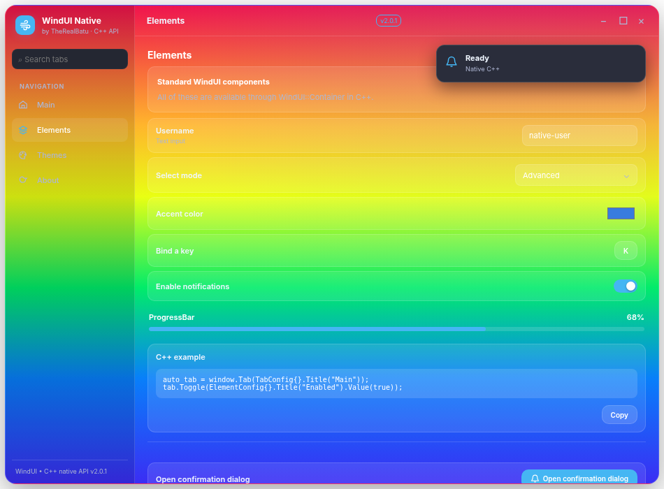
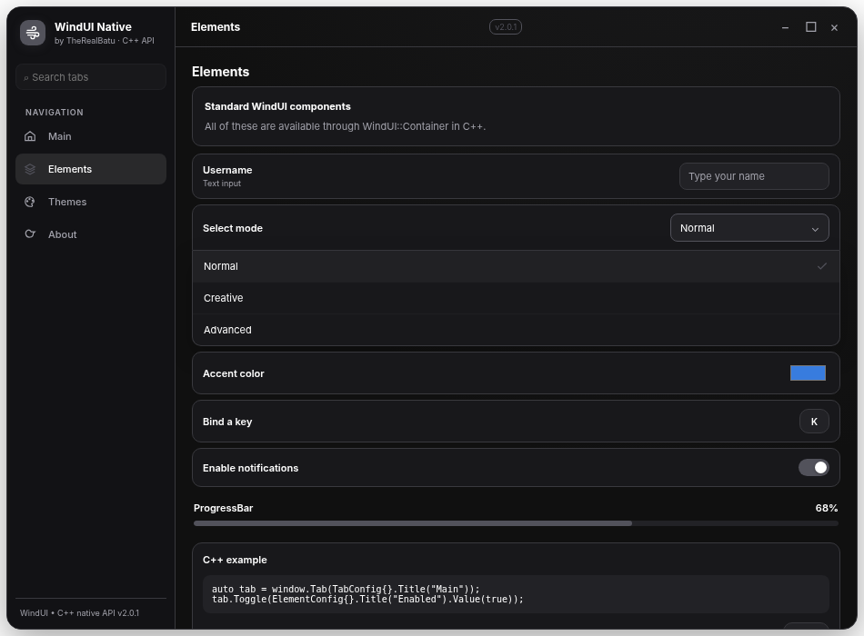

# WindUIBE

**C++17 WindUI-style UI library for Minecraft Bedrock Android / Levi Launchroid** · v2.0.1

[](LICENSE) [](#build) [](https://realbatu20.github.io/WindUIBE/)

WindUIBE is an **unofficial, independent port** inspired by [Footagesus/WindUI](https://github.com/Footagesus/WindUI) and the JNI/DEX loader architecture of [LumaUI](https://github.com/Zxwmwmwm/LumaUI). The C++ API constructs windows, tabs, controls, themes, dialogs, popups and notifications. A tiny Java/Dalvik bridge is used for Android event dispatch; the actual GUI is an **offline WebView renderer**, not Minecraft's internal UI engine.

**Status:** v2.0.1 was cross-compiled and verified with offline tests. **In-game Android runtime has not been verified on a physical device.** There are known partial implementations and Roblox-only features which are not available.

## Documentation

- **[Public docs site](https://realbatu20.github.io/WindUIBE/)** — GitHub Pages-ready; becomes available once Pages is enabled and this branch is merged.
- [Overview](docs/pages/01-overview.md) · [Quick start](docs/pages/02-quickstart.md) · [Windows & tabs](docs/pages/03-window.md)
- [Elements](docs/pages/04-elements.md) · [Themes](docs/pages/05-themes.md) · [Dialogs & popups](docs/pages/06-overlays.md)
- [Native C ABI](docs/pages/07-native.md) · [Build, verification & limitations](docs/pages/08-build.md)
- [API quick reference](API_REFERENCE.md) · [Full C++ example](examples/full_api_usage.cpp) · [Advanced theme example](examples/advanced_theme.cpp)

## Screenshots



The v2.0.1 release fixes the **Enable notifications** demo control to use a rounded toggle and replaces Android fullscreen dropdown pickers with **in-panel dropdown lists**.



## C++ API example

```cpp
#include "WindUI.hpp"
using namespace WindUI;

static void onValue(int id, const char* value, void*) {
    // Runs on the Android main UI thread.
}

void installUi() {
    auto window = CreateWindow(WindowConfig{}
        .Title("WindUIBE").Icon("wind")
        .Author("Native C++").Size(580,460).Theme("Dark"));
    auto tab = window.Tab(TabConfig{}.Title("Main").Icon("home"));
    tab.Toggle(ElementConfig{}.Title("Notifications").Value(true))
        .OnChange(onValue);
    tab.Dropdown(ElementConfig{}.Title("Mode")
        .Values(std::vector<std::string>{"Normal","Creative","Advanced"})
        .Value("Normal")).OnChange(onValue);
    tab.Slider(ElementConfig{}.Title("Volume").Range(0,100,50,1))
        .OnChange(onValue);
    Notify(NotificationConfig{}.Title("Ready").Duration(3));
}
```

## Build

Linux + Python 3 + Android NDK r28c:

```bash
ANDROID_NDK_HOME=/path/to/android-ndk-r28c ./build.sh
python3 tests/test_static.py
# Optional browser smoke test (Playwright/Chromium):
python3 tests/test_browser.py
```

Output: `dist/libWindUI.so`, `dist/libWindUI_2.0.1.levipack`. The default manifest version patterns are `"1.26.*"` and `"1.26.6*"` and **do not imply verified compatibility with each game build**.

See the [documentation](docs/pages/08-build.md) for launcher requirements, dynamic dependencies, troubleshooting, exact verification scope, and runtime caveats.

## Project layout

| Path | Description |
| --- | --- |
| `include/WindUI.hpp` | Typed C++17 API |
| `include/WindUI.h` | Exported C ABI for other native mods |
| `src/loader.cpp`, `src/Bridge.java` | Android/JNI loading and callbacks |
| `src/demo.cpp` | Native example UI |
| `assets/windui.html`, `assets/windui.js` | Offline WebView renderer |
| `tools/`, `build.sh` | DEX generation, embedding, NDK build and package |
| `examples/` | Public API usage and advanced theme map |
| `tests/` | Offline verification fixtures |
| `docs/` | Public static documentation site + Markdown sources |

## Credits

- [Footagesus/WindUI](https://github.com/Footagesus/WindUI) — original WindUI design and API inspiration (MIT).
- [Zxwmwmwm/LumaUI](https://github.com/Zxwmwmwm/LumaUI) — Android loader design inspiration (MIT).
- WindUIBE is a community port; neither upstream project endorses it. See [ATTRIBUTION.txt](ATTRIBUTION.txt) and [LICENSE](LICENSE).
